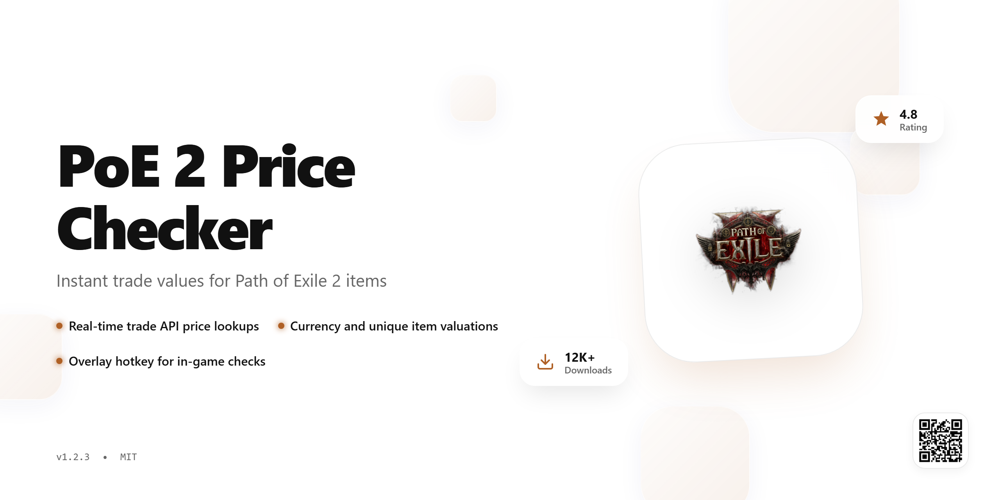

# 🎥 Price Tracker — Visual Workflow Media Editor

### 🖥️ PowerShell Setup

   

---

PoE 2 Price Checker turns the chaos of Wraeclast's economy into a clear, glanceable picture, letting you hover an item and instantly see what it's truly worth before you trade. Built for players who think in workflows, it slips a slim overlay beside your inventory so pricing data arrives without pulling you out of the action, and every lookup feeds directly into smarter buying, selling, and crafting calls. Whether you're flipping rares, hunting upgrades, or just want a second opinion on a drop, the checker keeps context a keystroke away. RuneshapePriceChecker is your quiet companion for reading the at a glance.

## ✅ Before You Start

- **OS:** Windows 10 / 11
- **Shell:** PowerShell 5.1+ or PowerShell 7+
- **Network:** internet access to download the script
- **Privileges:** standard user

## Features

**Live Pulse:** Price snapshots refresh on a rolling cadence, so the numbers you see reflect the current climate rather than stale listings from yesterday's economy.

- **Glanceable Overlay:** A compact, translucent readout floats above your game window, letting you read values without breaking focus or alt-tabbing away from the action.

- **League-Aware Tracking:** Item valuations stay tuned to the active league's economy, so seasonal shifts and mechanic-driven demand are reflected in what you see.

- **Featherweight Footprint:** The tool sips memory and leaves your frame rate untouched, keeping the game buttery while prices update quietly in the background.

- **Deep-Dive Handoff:** When a quick glance isn't enough, the readout connects you to extended item history and context for a fuller picture before you commit to a trade.

- **Workflow-First Hotkey:** One keypress surfaces pricing for whatever your cursor is hovering — inspect, evaluate, decide, and move on without leaving the flow of play.

## How it works

PoE 2 Price Checker is built around a simple loop: look, read, decide. The tool keeps a lightweight companion window synced to your screen, and every price you see comes from a live lookup in the background — nothing to refresh yourself, nothing to copy somewhere else.

Under the hood, the checker connects to a data stream and builds a local snapshot of what are for. A hotkey press captures the item under your cursor, sends a quick query, and returns the result in a compact overlay panel — readable at a glance, gone when you do not need it. The panel stays out of the way: it floats above the game, dims itself when your focus moves elsewhere, and never takes over your mouse.

The visual layer is kept deliberately minimal — a small card with the item name, the going rate, and a trend line that shows whether the value is trending up or dipping. You can pin several lookups side by side to compare, and the tool remembers your last checks so you can flip back through them like a short history strip.

Behind the scenes, the workflow is designed to feel invisible: launch the game windowed, open the overlay, and hover. The tool handles the rest — parceling out lookups, caching recent answers to keep things snappy, and quietly pulling fresh data in the background so the price you see is the price right now, not from ten minutes ago.

Because the interface is fully visual, there is no console to babysit and no config file to memorize. Every adjustment — refresh pacing, panel opacity, currency display — lives in a small settings panel with sliders and toggles. Change it, see it, keep playing.

## Workflow

🗺️ **From stash to strategy in four moves** — PoE 2 Price Checker is designed to feel like a natural extension of your rhythm, not another window to manage. Here's how a typical session flows:

1. **Launch alongside your game.** Open Path of Exile 2 first, then start PoE 2 Price Checker. The overlay settles quietly into the corner of your screen, ready without stealing focus.

2. **Hover to inspect.** Move your cursor over any item in your inventory or stash. The tool reads the item under your pointer and prepares a lookup in the background.

3. **Tap the hotkey.** Press the default shortcut and a compact price card blooms beside your cursor — recent listings, currency equivalents, and a quick snapshot of movement for that base type.

4. **Read the room, then decide.** Compare the suggested range against your own instincts, adjust your listing, and move on. The overlay fades back into the background until you need it again.

### 🔄 The loop that keeps you sharp

- **Scan → Compare → List → Repeat.** Each check takes seconds, so you can sweep a full stash tab without breaking concentration.
- **League-aware context.** Switch leagues inside the app and the price feed re-anchors to the current economy automatically.
- **Refresh on your terms.** The data window updates on a configurable cadence — tighten it during volatile trade hours, loosen it when you're mapping.
- **Search deeper when it matters.** From the price card, jump straight into a detailed item view inside PoE 2 Price Checker for history and comparable listings.

### 🎨 A visual language built for the overlay

The interface leans on soft contrast and color-coded tiers so your eyes can parse a price at a glance: warm tones for high-demand bases, cool tones for steady movers, and a muted neutral for anything sitting still. Transparency, theme, and currency display are all adjustable from the settings panel — shape the overlay until it disappears into your playstyle.

### 🧭 When the flow stutters

If a price card doesn't appear, confirm the game is running in **Windowed Fullscreen** so the overlay can draw above it, check that the app has the permissions it needs, and make sure no other tool has claimed your hotkey. A quick trip to the settings tab usually clears the path.

The whole workflow is built around one idea: fewer clicks between noticing an item and knowing what it's worth.

## FAQ

**Is the price data live or cached?** The checker pulls fresh values on a short refresh cycle, so the numbers you see hovering over an item reflect what traders were asking moments ago — not a stale snapshot from yesterday's economy.

**What display mode do I need?** Run Path of Exile 2 in Windowed Fullscreen. The overlay floats above your game window like a translucent HUD; exclusive fullscreen puts up a wall it can't cross.

**Can I reposition the overlay?** Yes. The price card is fully draggable and resizable — park it near your inventory, scale it down to a whisper, or dial the opacity until it reads like part of the game's own UI.

**How do I change the hotkey?** Open the Settings panel and rebind the price-check key to anything that won't collide with your skill bindings. Muscle memory is personal — make the tool fit yours.

**Where do the prices come from?** Live trade data is queried and distilled into a clean readout, so you get the going rate without alt-tabbing into a browser mid-map. The overlay shows the essentials; deeper item history is a click away.

**Does it slow the game down?** No. The footprint is deliberately lean — the overlay sips memory and stays out of your frame budget, so mapping stays smooth while prices update quietly in the background.

**Is this an accessible option for budget-minded exiles?** Absolutely. RuneshapePriceChecker is fully open and available to every player — no paywall, no premium tier, no locked features. The whole toolkit is yours from the first launch.

**What if the overlay won't appear?** Three usual suspects: you're in exclusive fullscreen, the app needs administrator rights, or your firewall is blocking its network calls. Fix those and the price card returns.

**Can I tune the refresh interval?** Yes — the Settings tab lets you stretch or tighten how often prices re-sync. Faster refresh suits volatile league starts; a slower cadence keeps things calm during steady.

**Does it support my league?** The checker follows the current league economy and its item pool. If a mechanic shifts the, the refresh cycle picks up the new baseline automatically.

**How do I report a problem or request a feature?** Drop a note in the project's Issues tab with a description and a screenshot when you can. Clear reports get patched fast — the tool evolves alongside the game's economy.

## License

PoE 2 Price Checker is released under the MIT License — a permissive, open agreement that keeps the canvas open for everyone.

In practical terms, the license gives you room to:
- **Use** the tool for any purpose, whether you're mapping solo or running a full workflow.
- **Study and remix** the source, adapting the overlay's look and behavior to fit your own screen and style.
- **Share copies** with friends or your guild, keeping the original notice attached.
- **Build on top of it** by merging the price-checker logic into your own projects.

The MIT License also includes the standard copyright and permission notice, plus the usual warranty and liability terms — the project is provided as-is, with no guarantees, and the authors are not responsible for how you use it.

In short: the license is the brush, not the fence. Fork it, reshape it, paint your own version — just keep the notice intact and pass the same openness forward.